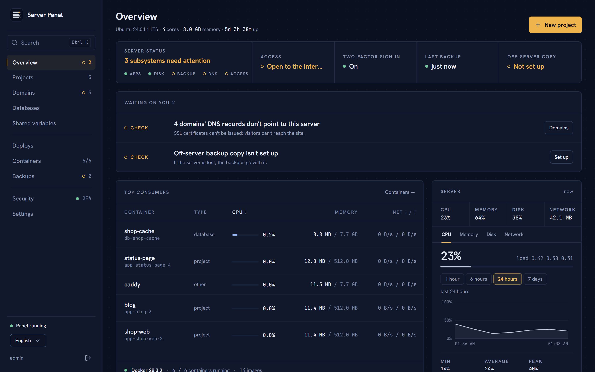
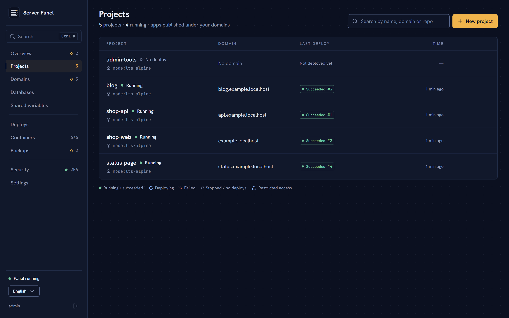
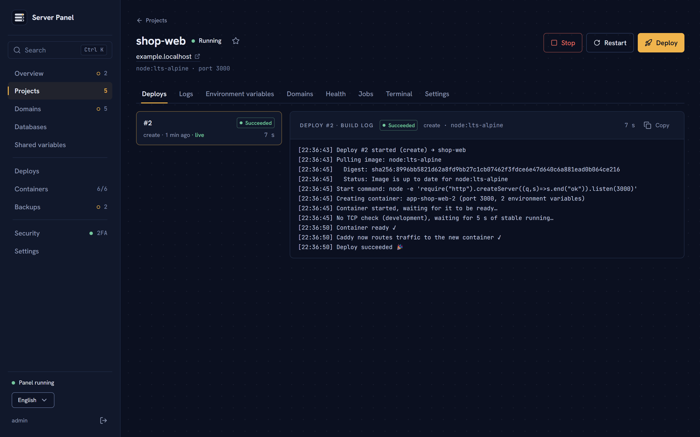
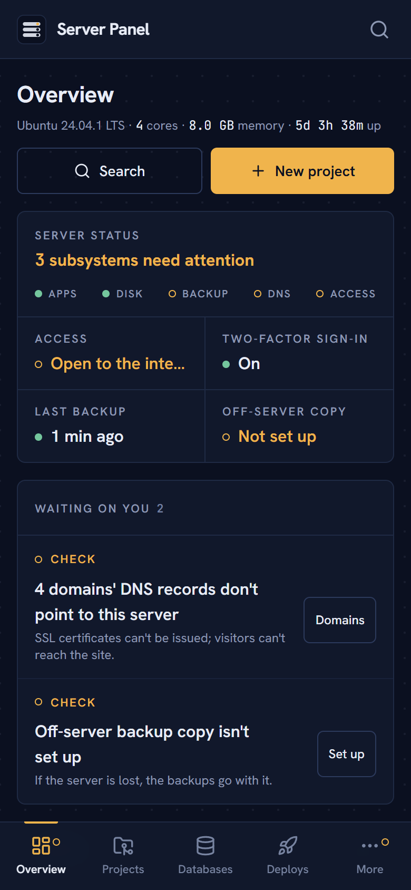

<p align="center">
  
</p>

<h1 align="center">Server Panel</h1>

<p align="center">
  Turn one server into your own small PaaS: deploy from GitHub, get HTTPS domains,<br>
  run databases, back everything up, and recover the whole box — from a panel only you can reach.
</p>

<p align="center">
  <a href="LICENSE"></a>
  
  
</p>

<p align="center">
  <a href="#quick-start">Quick start</a> ·
  <a href="#features">Features</a> ·
  <a href="#supported-platforms">Platforms</a> ·
  <a href="#security">Security</a> ·
  <a href="CONTRIBUTING.md">Contributing</a> ·
  <a href="README.tr.md">Türkçe</a>
</p>

<p align="center">
  
</p>

## Why

Hosted platforms are convenient until the bill, the limits or the lock-in arrive. A single rented
server is cheap and fast, but running it well means wiring Docker, a reverse proxy, certificates,
databases, backups and monitoring by hand — and keeping that wiring safe.

Server Panel does that wiring for you and stays out of the way:

- **Closed by default.** The panel is reachable only from your own devices over
  [Tailscale](https://tailscale.com), behind a password and mandatory 2FA. Your apps are public;
  the control plane is not.
- **One server, nothing hidden.** Everything runs as plain Docker containers next to a Caddy
  reverse proxy. No agents, no cluster, no proprietary runtime — `docker ps` shows the truth.
- **Your data stays yours.** Nightly backups, encrypted off-site copies to any S3-compatible
  storage with a recovery key only you hold, and a one-flow disaster recovery onto a new server.
- **Built to be read at a glance.** The overview tells you what needs you right now, with one
  action per item — on a desk or on a phone.

<table>
  <tr>
    <td width="50%"></td>
    <td width="50%"></td>
  </tr>
  <tr>
    <td align="center"><sub>Projects</sub></td>
    <td align="center"><sub>Zero-downtime deploys with live build logs</sub></td>
  </tr>
</table>

<p align="center">
  
  <br><sub>Designed for the phone too: check status, roll back, redeploy.</sub>
</p>

## Quick start

You need a server with a public IP, a domain whose DNS you control and a free Tailscale account.

```bash
# 1. On the server (Ubuntu, Debian, Fedora, RHEL/Rocky/Alma, Arch or openSUSE), as root:
curl -fsSLO https://raw.githubusercontent.com/cevikkursat/server-panel/main/deploy/install.sh
ADMIN_USER=admin bash install.sh        # copies root's SSH key to the new admin user

# 2. As the admin user:
git clone https://github.com/cevikkursat/server-panel.git /opt/panel/src
cd /opt/panel/src/deploy && cp .env.example .env && nano .env
docker compose up -d --build
docker logs panel | grep -i token        # one-time setup token
```

Then open `https://<your-panel>.ts.net` from a device on your tailnet, enter the token, and create
your account with 2FA. On Windows, run `deploy\install-windows.ps1` instead of step 1 —
see [Install on Windows](#install-on-windows-wsl2). The full walkthrough is below.

## Features

- **Zero-downtime deploys** from GitHub (GitHub App, push webhooks, commit statuses) or from a
  registry image. Dockerfile or auto-detected Node.js, static sites, Go and Python. One-click rollback.
- **PR previews** at `pr-<n>-<project>.<base domain>`, updated on every commit, removed when the PR closes.
- **Docker Compose projects**, health checks with optional auto-restart, cron tasks inside the app
  container, persistent folders, shared environment variables (encrypted at rest).
- **Domains:** `*.BASE_DOMAIN` subdomains and any domain you own (IDN supported), automatic HTTPS,
  www redirects, path-based routing to other projects, DNS and certificate status, Cloudflare proxy detection.
- **Restricted domains:** reachable only from your Tailscale devices and/or given IPs.
- **Databases:** PostgreSQL (optional pgvector), MySQL, MariaDB, MongoDB, Redis, Valkey and Orthanc
  (DICOM), internal network only, with a built-in data browser.
- **Backups:** nightly, with restore from the panel, plus encrypted off-site copies to any
  S3-compatible storage and a disaster-recovery flow.
- **Monitoring:** CPU, memory, disk and network history, per-container usage, a forecast of when
  the disk fills up, certificate expiry and pending updates.
- **Notifications:** e-mail (SMTP), Telegram, Discord.
- **Web terminal** into containers, live logs, audit log, command palette (`Ctrl K`).
- **Self-update** from the panel (git fast-forward + rebuild).
- **English and Turkish** interface and notifications; adding a language is one folder of
  translations ([how](CONTRIBUTING.md#translations)).

```
apps/api         Fastify + TypeScript backend (SQLite, Drizzle)
apps/web         React + Vite + Tailwind UI
packages/shared  Types and zod schemas shared by the API and the UI
deploy/          Host installers (Linux, Windows/WSL2), docker-compose, Caddyfile
docs/            Guides and screenshots
```

## Contents

- [Supported platforms](#supported-platforms)
- [Install on Linux](#install-on-linux)
- [Install on Windows (WSL2)](#install-on-windows-wsl2)
- [Tailscale setup](#tailscale-setup)
- [Updating](#updating)
- [Backups and recovery](#backups-and-recovery)
- [Security](#security)
- [How deploys work](#how-deploys-work)
- [Local development](#local-development)
- [Contributing](#contributing)
- [License](#license)

## Supported platforms

| Platform | Firewall | Auto updates | Notes |
|---|---|---|---|
| Ubuntu 24.04 / 22.04 | ufw | unattended-upgrades | Reference platform |
| Debian 12 | ufw | unattended-upgrades | |
| Fedora (current) | firewalld | dnf-automatic (security) | SELinux stays enforcing |
| RHEL / Rocky / AlmaLinux 9 | firewalld | dnf-automatic (security) | EPEL is enabled for fail2ban/htop |
| Arch Linux | ufw | not enabled (run `pacman -Syu`) | |
| openSUSE Leap 15.x | firewalld | daily `zypper patch` (security) timer | |
| openSUSE Tumbleweed | firewalld | not enabled (run `zypper dup`) | |
| Windows 10 (2004+) / 11 | Windows Firewall | Windows Update + the Linux distro's | Through WSL2 + Linux containers |
| Windows Server 2022 / 2025 | Windows Firewall | Windows Update + the Linux distro's | Through WSL2 + Linux containers |

systemd is required. Other distributions (Alpine, Gentoo, Void, NixOS, …) are rejected by the
installer with a message. Architectures: whatever Docker's packages and your distro support
(x86-64 and arm64).

Requirements: a machine with a public IP (or port forwarding for 80/443), 2 GB RAM or more,
a domain whose DNS you control, a free [Tailscale](https://tailscale.com) account.

## Install on Linux

The panel is **closed to the internet**; it opens only from devices on your Tailscale network
(computer, phone). The only internet-facing parts are your apps and a single webhook address
for GitHub push events.

```
Internet ──► Caddy :443 ──► apps (*.example.com, your own domains)
                       └──► deploy.example.com/api/github/webhook  (this path only)

Tailscale ──► host's Tailscale IP :443 ──► tailscale serve (raw TCP + PROXY) ──► 127.0.0.1:8443 ──► Caddy
                                                ├──► panel (panel.tailXXXX.ts.net)
                                                └──► "Tailscale only" domains (PR previews etc.)
```

### 1. DNS

At your DNS provider add:

| Type | Host | Value |
|------|------|-------|
| A    | `@`  | server IP |
| A    | `*`  | server IP |

The `*` record points app subdomains and the webhook address (`deploy.example.com`) at the
server. The panel needs no DNS record (it uses its Tailscale name).

### 2. Prepare the host

Do the [Tailscale setup](#tailscale-setup) first. If you do not have an SSH key: `ssh-keygen -t ed25519`.

```bash
scp deploy/install.sh root@SERVER_IP:/root/
ssh root@SERVER_IP
ADMIN_USER=admin SSH_PUBKEY="<contents of ~/.ssh/id_ed25519.pub>" bash /root/install.sh
```

The script detects the distribution (`/etc/os-release`) and then: updates the system and enables
automatic security updates, creates a sudo user with your key, hardens SSH (no root, no
passwords), sets up the firewall (ufw or firewalld: SSH, 80, 443), fail2ban, a swap file
(btrfs-aware), Docker Engine with the compose plugin, `/opt/panel`, and Tailscale with
`tailscale serve`. It is safe to run again.

Optional variables: `SSH_PORT`, `SWAP_SIZE` (default `4G`), `TZ_NAME` (e.g. `Europe/Berlin`;
default: keep the current timezone), `TS_AUTHKEY` (skip the browser login),
`TS_HOSTNAME` (default `panel`), `SSH_TAILSCALE_ONLY=1`.

To see what it would do without changing anything: `PANEL_DRY_RUN=1 bash install.sh`
(or `--dry-run`).

> **Important:** when the script finishes, test `ssh admin@SERVER_IP` in a new terminal
> before closing the current session.
>
> Optional: `SSH_TAILSCALE_ONLY=1` (or later `deploy/ssh-tailscale-only.sh`, which reverts itself
> after 5 minutes unless confirmed) closes SSH to the internet. If Tailscale breaks you can then
> only reach the server through your provider's web console.

**SELinux** (Fedora/RHEL/openSUSE) stays enforcing. The panel and Caddy containers run with
`label=disable` because they mount host paths (`/` read-only, `docker.sock`, the tailscaled socket).
Do not add `:z` to those mounts. If you choose a non-standard `SSH_PORT`, the installer labels it
for sshd with `semanage`.

### 3. Run the panel

```bash
# on the server, as ADMIN_USER
git clone https://github.com/cevikkursat/server-panel.git /opt/panel/src
cd /opt/panel/src/deploy
cp .env.example .env && nano .env         # PANEL_DOMAIN (ts.net name), WEBHOOK_DOMAIN, ACME_EMAIL, PUBLIC_IPV4/6, TAILSCALE_IPV4/6
docker compose up -d --build
docker logs panel | grep -i token         # first-run setup token
sudo bash /opt/panel/src/deploy/install-updater.sh   # once: lets the panel update itself
```

Then, from a device on your tailnet, open `https://PANEL_DOMAIN` (e.g. `https://panel.tail1234.ts.net`)
and finish the setup with the token: create the admin account and 2FA.

`PUBLIC_IPV4`/`PUBLIC_IPV6` must be addresses on the host's interfaces (`ip -br addr`): Caddy
binds 80/443 only there, because `tailscale serve` uses 443 on the Tailscale addresses.

To expose the panel to the internet anyway, set `PANEL_ACCESS=public` and `PANEL_DOMAIN=panel.example.com` in `.env`.

## Install on Windows (WSL2)

Windows 10 2004+, Windows 11, Windows Server 2022 and 2025 are supported through **WSL2 with a
dedicated Ubuntu 24.04 distro and Docker Engine inside it** (Linux containers; not Docker Desktop,
not Windows containers). Tailscale also runs inside the distro.

In an elevated PowerShell, from a checkout of this repository:

```powershell
powershell -ExecutionPolicy Bypass -File deploy\install-windows.ps1 -AdminUser admin
# optional: -TsAuthKey tskey-... -TsHostname panel -TzName Europe/Berlin -Networking auto|mirrored|nat
```

The script:

1. Checks the build (WSL2 needs Windows 10 build 19041+ / Server 2022 build 20348+).
2. Enables WSL. If Windows needs a reboot it says so and exits with code 3010: reboot and run it again.
3. Writes `%UserProfile%\.wslconfig`: `vmIdleTimeout=-1`, and `networkingMode=mirrored` on
   Windows 11 22H2+ / Server 2025 (ports opened in WSL are reachable on the Windows host's addresses).
   This file applies to every WSL distro on the machine, Docker Desktop's included.
4. Installs a distro named `PanelHost` with `wsl --install Ubuntu-24.04 --name PanelHost`. A
   dedicated name keeps any existing Ubuntu distro untouched. On a WSL version without `--name`,
   pass `-RootfsUrl` with an Ubuntu 24.04 WSL rootfs tarball and it uses `wsl --import`.
5. Enables systemd in the distro (`/etc/wsl.conf`) and keeps the Windows `PATH` out of it.
6. Opens Windows Firewall for 80/tcp, 443/tcp, 443/udp and 41641/udp (Tailscale), plus Hyper-V
   firewall rules for WSL in mirrored mode. On older builds (NAT mode) it adds `netsh interface
   portproxy` rules for 80/443 instead (HTTP/3 over UDP is not forwarded in NAT mode).
7. Registers a scheduled task (`PanelHost-Start`) that starts the distro at boot without a login
   and keeps it running; in NAT mode it also refreshes the port forwarding and `BIND_IPV4`.
8. Runs `deploy/install.sh` inside the distro. On WSL it skips what Windows handles: swap (set
   in `.wslconfig`), SSH hardening (administer through Windows), the Linux firewall and fail2ban.

Then continue with [Run the panel](#3-run-the-panel) inside the distro (`wsl -d PanelHost -u admin`):

- **Mirrored networking:** `PUBLIC_IPV4` is the Windows host's address. Forward 80/443 (TCP and
  UDP 443) on your router to it, or use the machine's public IP if it has one.
- **NAT mode:** `PUBLIC_IPV4` is your public IP; `BIND_IPV4` is the distro's `eth0` address
  (printed by the script, refreshed at every boot).
- Do not run Tailscale on Windows itself for this machine, and keep 80/443 free on Windows
  (IIS, Docker Desktop containers).
- If the panel does not come up after a reboot without anyone logging in, edit the
  `PanelHost-Start` task to "Run whether user is logged on or not" with a stored password.

## Tailscale setup

1. Create a free account at [tailscale.com](https://tailscale.com); install Tailscale on your
   computer and phone and sign in with the same account.
2. In the admin console, under **DNS**, enable **MagicDNS** and **HTTPS Certificates**
   (needed for the panel's `https://…ts.net` address and certificate).
3. The installer joins the server to your tailnet (a login link, or `TS_AUTHKEY`) and runs
   `tailscale serve --bg --tcp=443 --proxy-protocol=2 tcp://127.0.0.1:8443`: Caddy terminates
   TLS (the panel's .ts.net certificate comes from tailscaled) and learns the device's Tailscale IP
   from the PROXY header.
4. For **"Tailscale only" domains** (Project → Domains → Access: restricted; PR previews by
   default): public DNS still points at the server's public IP (for the Let's Encrypt certificate),
   and the panel runs a small DNS server on the host's Tailscale addresses (port 53) so tailnet
   devices reach those domains over Tailscale. Once, in the Tailscale admin console:
   **DNS → Add nameserver → Custom → `TAILSCALE_IPV4` · Restrict to domain: `BASE_DOMAIN`**.

## Updating

Run `sudo bash /opt/panel/src/deploy/install-updater.sh` once. It installs a systemd path unit
(`panel-updater.path`) that watches `/opt/panel/data/updater/request`. In **Settings → Panel
update** the panel can only ask to "check" or "update"; `deploy/update.sh` then runs on the host as
the admin user: `git fetch`, `git merge --ff-only` and `docker compose up -d --build`. The result
and log are written to `status.json` for the panel; new variables in `.env.example` that are
missing from your `.env` are reported. This works on every supported distro and in WSL2.

If the panel reports that the updater does not respond: `systemctl status panel-updater.path`.

Manual update: `cd /opt/panel/src && git pull --ff-only && cd deploy && docker compose up -d --build`.

## Backups and recovery

- **Backups** run nightly (03:00 in the panel's timezone) and are kept 7 days by default.
  PostgreSQL, MySQL, MariaDB and MongoDB backups can be restored from the panel (a safety backup
  is taken first). Redis and panel backups are downloaded and restored by hand (the panel backup
  contains a README). Persistent folders are included as tar.gz.
- Local backups live on the server's disk: if the server is lost, they are lost too.
- **Off-site copies** (Backups → Off-site copy): every successful backup is encrypted with
  AES-256-GCM on the server and uploaded to S3-compatible storage (Cloudflare R2, Backblaze B2, …).
  The key is a separate **recovery key**, shown after a 2FA check; keep it in a password manager.
- **Back up `/opt/panel/data/secret.key`**: environment variables are encrypted with it; without
  it encrypted values cannot be recovered.
- **Disaster recovery** (server lost):
  1. Install the panel on a new server and log in with a temporary account.
  2. Backups → Off-site copy: enter the same bucket and "use an existing recovery key".
  3. Cloud backups → newest `panel-…` backup → "Download to server" → "Restore" (2FA). The panel
     restarts; log in with your old account. Projects, variables, domains and settings return.
  4. **Disaster recovery** card → "Start recovery": databases are recreated with the same name,
     version and password and their latest backups loaded, projects deployed, persistent folders
     filled. Nothing existing is overwritten.
  5. Write `deploy/.env` for the new server and point your domains' DNS at the new IP.
- If the panel does not run at all, a single file can be decrypted with
  `docker exec -it panel node /app/api/dist/cli.js decrypt-backup /data/x.enc /data/x`.

## Security

The panel has `docker.sock` access, i.e. root-equivalent rights on the host. Layers that keep it
to its owner (summarised on the **Security** page):

- **Closed to the internet:** only tailnet devices reach it. The only public panel path is the
  GitHub webhook (signature-verified; nothing else is reachable from that host name). App
  containers on the same Docker network are refused.
- **Single account + mandatory 2FA.** Setup uses a one-time token from the server log; no new
  accounts afterwards. Every 2FA code works once.
- **Brute-force protection:** 5 attempts per minute per IP, plus an account-wide 15-minute lock
  after 10 failures in 15 minutes.
- **Sessions** end after 12 hours idle, 7 days at most; can be listed and revoked.
- **Notifications** on every login and on suspicious attempts; optional IP allowlist.
- SameSite=Strict cookies, origin checks, CSP; session tokens stored as SHA-256, passwords with
  argon2, environment variables AES-256-GCM; an audit log of every action.
- Docker bypasses ufw/firewalld for published ports, so apps never publish ports; only Caddy does.
  Caddy's admin API is on a unix socket shared with the panel only.

Emergency commands (over SSH, or `wsl -d PanelHost` on Windows):

```bash
docker exec panel node /app/api/dist/cli.js unlock            # remove the login lock
docker exec panel node /app/api/dist/cli.js clear-allowlist   # remove the IP allowlist (then: docker restart panel)
docker exec panel node /app/api/dist/cli.js logout-all        # end all sessions
docker exec panel node /app/api/dist/cli.js reset-admin --yes   # lost 2FA: reset the account (projects/data stay)
```

## How deploys work

1. **GitHub source:** shallow clone (the token goes in a one-time header, `.git` is removed before
   the build). A Dockerfile is used if present; otherwise the type is detected and a Dockerfile
   generated (`package.json` → Node.js or static build, `go.mod` → Go, `requirements.txt` /
   `pyproject.toml` → Python, `index.html` → static). Builds use BuildKit, one at a time.
2. **Image source:** pulled from the registry.
3. The new container starts next to the old one; it gets a `PORT` variable.
4. Readiness: the Docker healthcheck, or a TCP port check.
5. Caddy switches traffic, the old container stops 3 s later. Any failure removes the new
   container and leaves the old version untouched. The commit status shows ✓ / ✗ on GitHub.

Connect GitHub under **Settings → GitHub → Create GitHub App** (create it from the server's panel so
webhooks go to `WEBHOOK_DOMAIN`). Apps can reach each other at `http://<project>:<port>` on the
`panel-apps` network (`172.31.0.0/16`; trust `X-Forwarded-*` only from there).

## Local development

```bash
pnpm install
docker compose -f deploy/docker-compose.dev.yml up -d   # local Caddy (:8080, admin :2019)
pnpm dev          # API :3100, UI :5173 (Vite proxies /api to the API)
```

The API log prints a first-run setup token; enter it at http://localhost:5173. Projects open at
`http://<project>.localhost:8080`. Data lives in `apps/api/data` (delete it to start over).

Step-by-step guide with checks: [docs/local-development.md](docs/local-development.md)
(Turkish: [docs/local-development.tr.md](docs/local-development.tr.md)). The UI's visual language
is described in `DESIGN.md`, the product in `PRODUCT.md`.

## Contributing

Issues and pull requests are welcome. [CONTRIBUTING.md](CONTRIBUTING.md) covers the development
setup, the code layout, how to add a language, and what to check before opening a PR. Please report
security problems privately as described in [SECURITY.md](SECURITY.md), not in public issues.

## License

[MIT](LICENSE)
