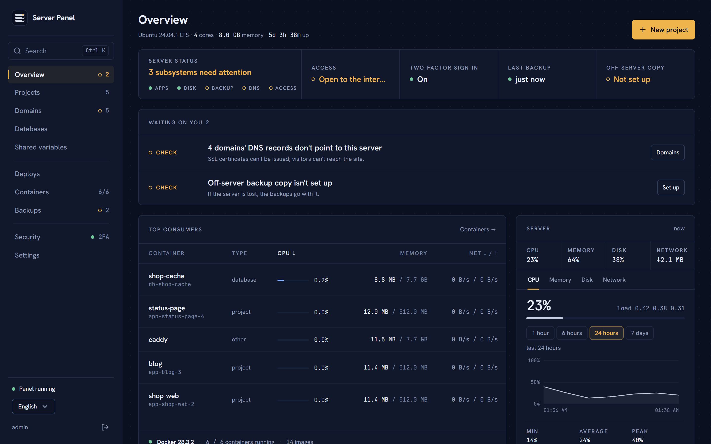
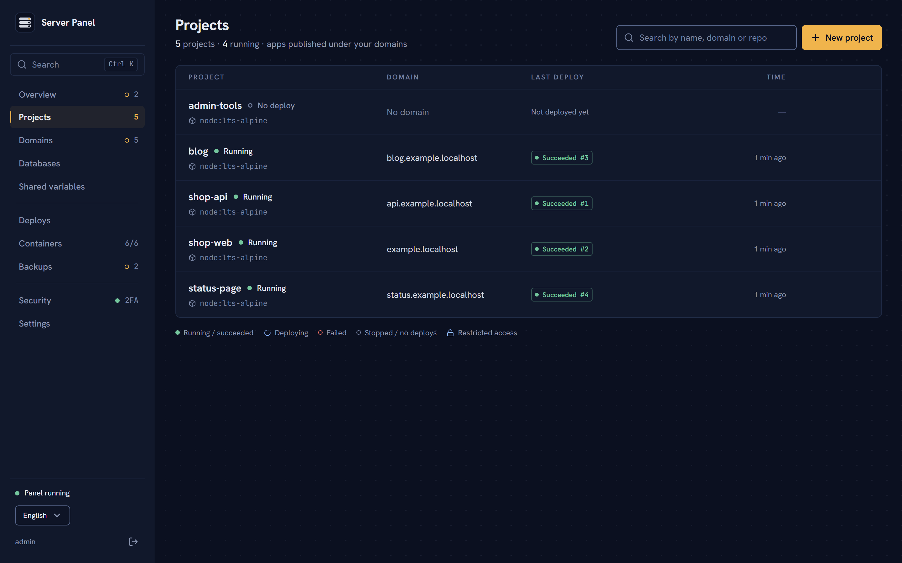
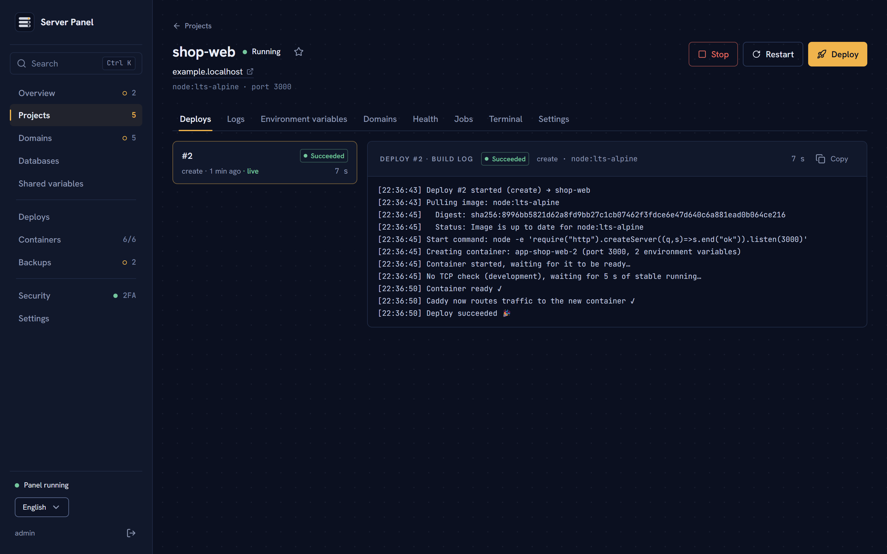
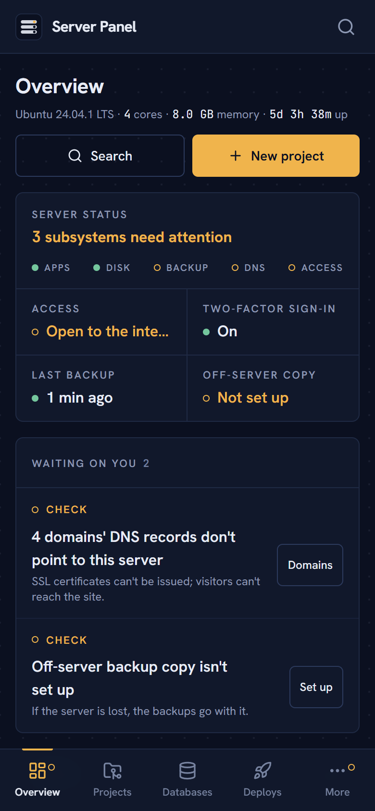

<p align="center">
  
</p>

<h1 align="center">Sunucu Paneli</h1>

<p align="center">
  Tek bir sunucuyu kendi küçük PaaS'ına çevir: GitHub'dan deploy, HTTPS'li domainler,<br>
  veritabanları, yedekler ve tüm sunucuyu geri kurma — yalnız senin erişebildiğin bir panelden.
</p>

<p align="center">
  <a href="LICENSE"></a>
  
  
</p>

<p align="center">
  <a href="#hızlı-başlangıç">Hızlı başlangıç</a> ·
  <a href="#desteklenen-platformlar">Platformlar</a> ·
  <a href="#güvenlik">Güvenlik</a> ·
  <a href="CONTRIBUTING.md">Katkı</a> ·
  <a href="README.md">English</a>
</p>

<p align="center">
  
</p>

## Neden

Hazır platformlar fatura, limit ya da bağımlılık gelene kadar rahattır. Kiralık tek bir sunucu ucuz
ve hızlıdır; ama onu iyi işletmek Docker'ı, ters vekili, sertifikaları, veritabanlarını, yedekleri
ve izlemeyi elle bağlamak ve bu düzeni güvende tutmak demektir.

Sunucu Paneli bu bağlantıları senin yerine kurar ve yolundan çekilir:

- **Varsayılan olarak kapalı.** Panel yalnız [Tailscale](https://tailscale.com) üzerinden kendi
  cihazlarından açılır; şifre ve zorunlu 2FA ile. Uygulamaların herkese açık, yönetim paneli değil.
- **Tek sunucu, gizli bir şey yok.** Her şey bir Caddy ters vekilinin yanında düz Docker
  container'ları olarak çalışır. Ajan yok, küme yok, özel çalışma ortamı yok — `docker ps` gerçeği gösterir.
- **Veri senin.** Gece yedekleri, yalnız senin tuttuğun kurtarma anahtarıyla şifrelenip herhangi bir
  S3 uyumlu depoya giden sunucu dışı kopyalar ve yeni bir sunucuya tek akışta felaket kurtarma.
- **Bir bakışta okunur.** Genel Bakış şu an seni neyin beklediğini, her biri için tek bir eylemle
  söyler — masada da telefonda da.

<table>
  <tr>
    <td width="50%"></td>
    <td width="50%"></td>
  </tr>
  <tr>
    <td align="center"><sub>Projeler</sub></td>
    <td align="center"><sub>Canlı build loglu, kesintisiz deploy</sub></td>
  </tr>
</table>

<p align="center">
  
  <br><sub>Telefon için de tasarlandı: durumu gör, geri dön, yeniden deploy et.</sub>
</p>

<sub>Ekran görüntüleri İngilizce arayüzden; panel Türkçe ve İngilizce çalışır.</sub>

## Hızlı başlangıç

Gerekenler: genel IP'li bir sunucu, DNS'ini yönettiğin bir domain ve ücretsiz bir Tailscale hesabı.

```bash
# 1. Sunucuda (Ubuntu, Debian, Fedora, RHEL/Rocky/Alma, Arch ya da openSUSE), root olarak:
curl -fsSLO https://raw.githubusercontent.com/cevikkursat/server-panel/main/deploy/install.sh
ADMIN_USER=admin bash install.sh        # root'un SSH anahtarını yeni yönetici kullanıcısına kopyalar

# 2. Yönetici kullanıcısıyla:
git clone https://github.com/cevikkursat/server-panel.git /opt/panel/src
cd /opt/panel/src/deploy && cp .env.example .env && nano .env
docker compose up -d --build
docker logs panel | grep -i token        # tek seferlik kurulum token'ı
```

Sonra Tailscale'e bağlı bir cihazdan `https://<panelin>.ts.net` adresini aç, token'ı gir ve 2FA'lı
hesabını oluştur. Windows'ta 1. adım yerine `deploy\install-windows.ps1` çalıştırılır — bkz.
[Windows'a kurulum](#windowsa-kurulum-wsl2). Ayrıntılı anlatım aşağıda.

## Yerelde geliştirme

```bash
pnpm install
docker compose -f deploy/docker-compose.dev.yml up -d   # yerel Caddy (:8080, admin :2019)
pnpm dev          # API :3100, arayüz :5173 (Vite /api isteklerini API'ye yönlendirir)
```

İlk açılışta API logunda tek seferlik kurulum token'ı yazılır. http://localhost:5173
adresindeki kurulum ekranında bu token'ı girip admin hesabını ve 2FA'yı oluşturun.

Yerelde projeler `http://<proje>.localhost:8080` adresinde açılır (Chrome/Firefox
`*.localhost`'u otomatik olarak bu bilgisayara yönlendirir).

Veritabanı `./data/panel.db`, şifreleme anahtarı `./data/secret.key` içinde tutulur.
Sıfırlamak için `data/` klasörünü silin.

## Desteklenen platformlar

| Platform | Firewall | Otomatik güncelleme | Not |
|---|---|---|---|
| Ubuntu 24.04 / 22.04 | ufw | unattended-upgrades | Referans platform |
| Debian 12 | ufw | unattended-upgrades | |
| Fedora (güncel) | firewalld | dnf-automatic (güvenlik) | SELinux enforcing kalır |
| RHEL / Rocky / AlmaLinux 9 | firewalld | dnf-automatic (güvenlik) | fail2ban/htop için EPEL açılır |
| Arch Linux | ufw | açılmaz (`pacman -Syu` ile elle) | |
| openSUSE Leap 15.x | firewalld | günlük `zypper patch` (güvenlik) zamanlayıcısı | |
| openSUSE Tumbleweed | firewalld | açılmaz (`zypper dup` ile elle) | |
| Windows 10 (2004+) / 11 | Windows Firewall | Windows Update + Linux dağıtımınınki | WSL2 + Linux container'ları ile |
| Windows Server 2022 / 2025 | Windows Firewall | Windows Update + Linux dağıtımınınki | WSL2 + Linux container'ları ile |

systemd gerekir. Diğer dağıtımlar (Alpine, Gentoo, Void, NixOS…) kurulum scripti tarafından
bir mesajla reddedilir.

## Sunucuya kurulum (Linux)

Panel **internete kapalıdır**; sadece Tailscale ağınızdaki cihazlardan (bilgisayar, telefon)
açılır. İnternete açık olan tek şey uygulamalarınız ve GitHub'ın push bildirimlerini aldığı
tek bir webhook adresidir.

```
İnternet ──► Caddy :443 ──► uygulamalar (*.ornek.com, kendi domainleriniz)
                       └──► deploy.ornek.com/api/github/webhook  (sadece bu yol)

Tailscale ──► sunucunun Tailscale IP'si :443 ──► tailscale serve (ham TCP + PROXY) ──► 127.0.0.1:8443 ──► Caddy
                                                     ├──► panel (sunucu.tailXXXX.ts.net)
                                                     └──► "sadece Tailscale" domainleri (PR önizlemeleri vb.)
```

`tailscale serve --bg --tcp=443 --proxy-protocol=2 tcp://127.0.0.1:8443`: TLS'i Caddy çözer
(panelin .ts.net sertifikası tailscaled'den), cihazın Tailscale IP'sini PROXY başlığından öğrenir.

### 0. Tailscale hesabı
1. [tailscale.com](https://tailscale.com)'da ücretsiz hesap açın; bilgisayarınıza ve telefonunuza
   Tailscale'i kurup aynı hesapla giriş yapın.
2. Yönetim panelinde **DNS** sayfasında **MagicDNS** ve **HTTPS Certificates**'ı açın
   (panelin `https://…ts.net` adresi ve sertifikası için gerekli).

### 1. DNS
Alan adınızı aldığınız yerin DNS ayarlarına girin ve şu kayıtları ekleyin:

| Tür | Host | Değer |
|-----|------|-------|
| A   | `@`  | sunucu IP |
| A   | `*`  | sunucu IP |

`*` kaydı uygulama alt domainlerini ve webhook adresini (`deploy.ornek.com`) sunucuya
yönlendirir. Panel için DNS kaydı gerekmez (Tailscale adresini kullanır).

### 2. Sunucu hazırlığı
Kendi bilgisayarınızda bir SSH anahtarınız yoksa: `ssh-keygen -t ed25519`

```bash
scp deploy/install.sh root@SUNUCU_IP:/root/
ssh root@SUNUCU_IP
ADMIN_USER=admin SSH_PUBKEY="$(cat ~/.ssh/id_ed25519.pub içeriği)" bash /root/install.sh
```

Script dağıtımı `/etc/os-release`'ten algılar; sistemi günceller ve otomatik güvenlik
güncellemelerini açar, anahtarınızla sudo yetkili kullanıcı oluşturur, SSH'ı sıkılaştırır (root ve
şifreli giriş kapalı), firewall'u (ufw ya da firewalld: SSH, 80, 443), fail2ban'ı, swap dosyasını
(btrfs dahil), Docker Engine + compose eklentisini, `/opt/panel`'i ve `tailscale serve` ile
Tailscale'i kurar. Tekrar çalıştırılabilir.

İsteğe bağlı değişkenler: `SSH_PORT`, `SWAP_SIZE` (varsayılan `4G`), `TZ_NAME` (ör. `Europe/Istanbul`;
boşsa sunucunun saat dilimi değişmez), `TS_AUTHKEY`, `TS_HOSTNAME` (varsayılan `panel`),
`SSH_TAILSCALE_ONLY=1`. Hiçbir şeyi değiştirmeden ne yapacağını görmek için:
`PANEL_DRY_RUN=1 bash install.sh` (ya da `--dry-run`).

Script sonunda Tailscale bir onay bağlantısı verir; tarayıcıda açıp sunucuyu hesabınıza ekleyin
(ya da `TS_AUTHKEY=tskey-…` ile önceden verin). Bittiğinde panelin Tailscale adresini yazar.

**SELinux** (Fedora/RHEL/openSUSE) enforcing kalır. Panel ve Caddy container'ları host yollarını
bağladıkları için (`/` salt okunur, `docker.sock`, tailscaled soketi) `label=disable` ile çalışır;
bu bağlamalara `:z` eklemeyin. Standart dışı bir `SSH_PORT` seçilirse script portu `semanage` ile
sshd için etiketler.

> **Önemli:** Script bitince mevcut oturumu kapatmadan yeni bir terminalde
> `ssh admin@SUNUCU_IP` ile girişi test edin.
>
> İsteğe bağlı: `SSH_TAILSCALE_ONLY=1` ile SSH da internete kapanır (sadece Tailscale). Tailscale
> sorun yaşarsa sunucuya yalnızca sağlayıcının web konsolundan erişebilirsiniz.

### 3. Paneli çalıştırma
```bash
# sunucuda, ADMIN_USER kullanıcısıyla
git clone https://github.com/cevikkursat/server-panel.git /opt/panel/src
cd /opt/panel/src/deploy
cp .env.example .env && nano .env       # PANEL_DOMAIN (ts.net adresi), WEBHOOK_DOMAIN, ACME_EMAIL, PUBLIC_IPV4/6, TAILSCALE_IPV4/6
docker compose up -d --build
docker logs panel | grep -i token        # ilk kurulum token'ı
sudo bash /opt/panel/src/deploy/install-updater.sh   # paneli panelden güncelleyebilmek için (bir kez)
```

Ardından Tailscale'e bağlı bir cihazdan `https://PANEL_DOMAIN` (ör. `https://sunucu.tail1234.ts.net`)
adresinde kurulumu tamamlayın.

Paneli yine de internete açmak isterseniz `.env`'de `PANEL_ACCESS=public` ve `PANEL_DOMAIN=panel.ornek.com` yapın.

## Windows'a kurulum (WSL2)

Windows 10 2004+, Windows 11, Windows Server 2022 ve 2025, **WSL2 içinde ayrı bir Ubuntu 24.04
dağıtımı ve onun içindeki Docker Engine** ile desteklenir (Linux container'ları; Docker Desktop ve
Windows container'ları değil). Tailscale de bu dağıtımın içinde çalışır.

Yönetici olarak açılmış PowerShell'de, reponun bulunduğu klasörde:

```powershell
powershell -ExecutionPolicy Bypass -File deploy\install-windows.ps1 -AdminUser admin
# isteğe bağlı: -TsAuthKey tskey-... -TsHostname panel -TzName Europe/Istanbul -Networking auto|mirrored|nat
```

Script şunları yapar:

1. Windows sürümünü kontrol eder (WSL2 için Windows 10 build 19041+ / Server 2022 build 20348+).
2. WSL'i açar. Windows yeniden başlatma isterse bunu söyleyip 3010 koduyla çıkar: yeniden başlatıp
   scripti tekrar çalıştırın, kaldığı yerden devam eder.
3. `%UserProfile%\.wslconfig` dosyasına `vmIdleTimeout=-1` ve Windows 11 22H2+ / Server 2025'te
   `networkingMode=mirrored` yazar (WSL'de açılan portlar Windows'un adreslerinden erişilir). Bu dosya
   bilgisayardaki tüm WSL dağıtımlarını (Docker Desktop'ınkiler dahil) etkiler.
4. `wsl --install Ubuntu-24.04 --name PanelHost` ile `PanelHost` adlı ayrı bir dağıtım kurar; var olan
   bir Ubuntu dağıtımına dokunulmaz. `--name` desteklemeyen eski bir WSL'de `-RootfsUrl` ile verilen
   Ubuntu 24.04 WSL rootfs arşivini `wsl --import` ile kurar.
5. Dağıtımda systemd'yi açar (`/etc/wsl.conf`) ve Windows `PATH`'ini dışarıda tutar.
6. Windows Firewall'da 80/tcp, 443/tcp, 443/udp ve 41641/udp'yi (Tailscale) açar; mirrored modda WSL
   için Hyper-V firewall kurallarını da ekler. Eski sürümlerde (NAT modu) 80/443 için `netsh interface
   portproxy` kuralları ekler (NAT modunda UDP üzerinden HTTP/3 aktarılmaz).
7. Açılışta oturum açılmadan dağıtımı başlatıp çalışır tutan bir zamanlanmış görev (`PanelHost-Start`)
   kaydeder; NAT modunda port yönlendirmesini ve `BIND_IPV4`'ü de her açılışta günceller.
8. Dağıtımın içinde `deploy/install.sh`'ı çalıştırır. WSL'de Windows'un üstlendiği adımları atlar: swap
   (`.wslconfig`'te), SSH sıkılaştırma (yönetim Windows üzerinden), Linux firewall'u ve fail2ban.

Ardından dağıtımın içinde (`wsl -d PanelHost -u admin`) "3. Paneli çalıştırma" adımlarıyla devam edin:

- **Mirrored ağ:** `PUBLIC_IPV4` Windows'un adresidir. Modeminizde 80/443'ü (TCP ve UDP 443) bu adrese
  yönlendirin ya da bilgisayarın genel IP'si varsa onu yazın.
- **NAT modu:** `PUBLIC_IPV4` genel IP'nizdir; `BIND_IPV4` dağıtımın `eth0` adresidir (script yazar,
  her açılışta güncellenir).
- Bu bilgisayarda Windows'un kendisinde Tailscale çalıştırmayın; Windows'ta 80/443'ü boş tutun (IIS,
  Docker Desktop container'ları).
- Yeniden başlatmadan sonra kimse oturum açmadan panel açılmıyorsa `PanelHost-Start` görevini
  "Kullanıcı oturum açmış olsun ya da olmasın çalıştır" ve kayıtlı şifreyle düzenleyin.

## Güncelleme

`sudo bash /opt/panel/src/deploy/install-updater.sh` bir kez çalıştırılır. Bu,
`/opt/panel/data/updater/request` dosyasını izleyen bir systemd path birimi (`panel-updater.path`)
kurar. Panel **Ayarlar → Panel güncelleme**'den sadece "kontrol et" ve "güncelle" isteyebilir;
`deploy/update.sh` host'ta admin kullanıcısıyla `git fetch`, `git merge --ff-only` ve
`docker compose up -d --build` çalıştırır. Sonuç ve log panelin okuduğu `status.json`'a yazılır;
`.env.example`'da olup `.env`'de olmayan yeni değişkenler bildirilir. Tüm desteklenen dağıtımlarda ve
WSL2'de çalışır. Güncelleyici yanıt vermiyorsa: `systemctl status panel-updater.path`.

## Güvenlik
Panel `docker.sock` erişimine sahip, yani sunucuda root'a denk yetkisi var. Bu yüzden
panele sadece sahibinin girebilmesi için katmanlı önlemler var (**Güvenlik** sayfasında özetlenir):

- **Panel internete kapalı:** sadece Tailscale ağınızdaki cihazlardan açılır. İnternete açık tek
  panel yolu GitHub webhook'udur (imzayla doğrulanır; o adresten panelin başka hiçbir yerine
  ulaşılamaz). Panelin özel portu sadece sunucunun kendisine açıktır; aynı Docker ağındaki
  uygulama container'ları da reddedilir.
- **Tek hesap + zorunlu 2FA.** Kurulum, sunucu logundaki tek seferlik token ile yapılır;
  sonrasında yeni hesap açılamaz. Her 2FA kodu yalnızca bir kez kullanılabilir.
- **Kaba kuvvet koruması.** IP başına dakikada 5 deneme; ayrıca hesap genelinde 15 dakikada
  10 başarısız denemede giriş 15 dakika tamamen kapanır (çok sayıda IP'den denense bile).
- **Oturumlar** 12 saat hareketsizlikte, en geç 7 günde kapanır. Aktif oturumlar görülüp
  kapatılabilir; şifre değişince diğer oturumlar kapanır.
- **Bildirimler:** her girişte ve şüpheli denemelerde e-postayla (isteğe bağlı Telegram/Discord) haber gelir.
- **İsteğe bağlı IP kısıtlaması:** panel sadece belirlenen IP/aralıklardan açılır
  (GitHub webhook hariç; o imzayla doğrulanır). Kendi IP'nizi içermeyen liste kaydedilemez.
- **Ağ kapısı:** production'da panel sadece `panel-internal` ağındaki Caddy'den gelen
  bağlantıları kabul eder; aynı sunucudaki uygulama container'ları panele ulaşamaz.
- **Tarayıcı korumaları:** SameSite=Strict cookie, değişiklik isteklerinde origin kontrolü,
  CSP, X-Frame-Options. API yanıtları önbelleğe alınmaz.
- Oturum token'ları veritabanında SHA-256 hash olarak saklanır. Şifreler argon2 ile hashlenir.
- Her işlem (giriş, terminal açma, yedek indirme…) işlem kaydına yazılır.

### Acil durum komutları (sunucuya SSH ile; Windows'ta `wsl -d PanelHost`)
```bash
docker exec panel node /app/api/dist/cli.js unlock            # giriş kilidini kaldır
docker exec panel node /app/api/dist/cli.js clear-allowlist   # IP kısıtlamasını kaldır (sonra: docker restart panel)
docker exec panel node /app/api/dist/cli.js logout-all        # tüm oturumları kapat
docker exec panel node /app/api/dist/cli.js reset-admin --evet  # 2FA kaybı: hesabı sıfırla (projeler/veriler kalır)
```

### Diğer notlar
- Docker yayınlanan portlarda ufw/firewalld'yi atlar. Bu yüzden uygulamalar asla `ports:` ile
  yayınlanmaz, sadece Caddy üzerinden `panel-apps` ağına bağlanır.
- Caddy admin API'si TCP'de değil, sadece panelle paylaşılan bir unix socket'te dinler.
  Uygulama container'ları Caddy ayarını değiştiremez.
- Panel, `X-Forwarded-For` başlığına yalnızca `panel-internal` ağındaki Caddy'den
  geldiğinde güvenir.
- Ortam değişkenleri AES-256-GCM ile şifreli saklanır. **`/opt/panel/data/secret.key`
  dosyasını yedekleyin**; kaybolursa şifreli değerler geri alınamaz.

## GitHub bağlantısı
Panelde **Ayarlar → GitHub → GitHub App oluştur**'a basın. GitHub'da önceden doldurulmuş
bir sayfa açılır; *Create* deyip panele dönün, ardından **App'i kur ve repo seç** ile
erişeceği repoları seçin. Private key ve webhook secret panelde şifreli saklanır.

- İzinler: repo içeriği (salt okunur), commit durumu (yazma). Olay: `push`.
- App'i **sunucudaki panelden** (Tailscale adresi, `https://sunucu.tailXXXX.ts.net`) oluşturun.
  Webhook adresi otomatik olarak `WEBHOOK_DOMAIN` (ör. `deploy.ornek.com`) olur. Localhost'tan
  oluşturulan App'e GitHub webhook gönderemez (manuel deploy yine çalışır).

## Deploy nasıl çalışır?
1. **GitHub kaynağı:** repo `git clone --depth 1` ile çekilir (token URL'ye değil tek seferlik
   başlığa konur, `.git` build'den önce silinir). Dockerfile varsa o kullanılır, yoksa tür
   algılanıp Dockerfile üretilir (deploy logunda görünür):

   | Bulunan dosya | Tür | Nasıl çalışır |
   |---|---|---|
   | `Dockerfile` | Dockerfile | Olduğu gibi |
   | `package.json` + `start` script | Node.js | npm/pnpm/yarn (lockfile'a göre), `build` varsa çalışır |
   | `package.json` + sadece `build` | Statik site | Node ile build, `dist/`/`build/`/`out/` Caddy ile sunulur (SPA destekli) |
   | `go.mod` | Go | Statik binary, alpine üzerinde |
   | `requirements.txt` / `pyproject.toml` | Python | Başlatma komutu veya `Procfile` gerekir |
   | `index.html` | Statik site | Caddy ile sunulur |

   Build'ler BuildKit ile yapılır; aynı anda tek build çalışır. Son 5 build image'ı saklanır.
2. **Image kaynağı:** image registry'den çekilir.
3. Yeni container `app-<proje>-<deployId>` adıyla başlatılır (eskisi çalışmaya devam eder).
   Uygulamaya `PORT` ortam değişkeni otomatik verilir.
4. Hazır olması beklenir: Docker healthcheck varsa o, yoksa TCP port kontrolü.
5. Caddy trafiği yeni container'a çevirir, 3 sn sonra eski container kapatılır.
6. Herhangi bir adım başarısız olursa yeni container silinir; eski sürüm hiç etkilenmez.
7. GitHub'da commit'in yanında deploy durumu (✓ / ✗) görünür.

Eski bir başarılı deploy'a **Deploylar** sekmesinden tek tıkla geri dönülebilir.

## Veritabanları ve yedekler
- **Veritabanları** sayfasından PostgreSQL (isteğe bağlı pgvector), MySQL, MariaDB, MongoDB, Redis veya Valkey kurulur.
  Aynı yerden **Orthanc** (DICOM görüntü sunucusu) da kurulur: görüntüler sunucunun diskinde ya da doğrudan S3 uyumlu
  bir depoda (R2 vb.; sunucuda sadece dizin kalır) saklanır; "Projeye bağla" `ORTHANC_URL`, `ORTHANC_USERNAME`,
  `ORTHANC_PASSWORD` yazar. Orthanc dizin dosyasını kilitlediği için yedek alınırken Orthanc kısa süre durdurulur
  (S3 modunda birkaç saniye, disk modunda görüntülerin boyutuyla orantılı); bu sırada "durdu" bildirimi gönderilmez. Container `db-<isim>`
  adıyla sadece iç ağda çalışır, veriler `panel-db-<isim>` volume'ünde tutulur. "Projeye bağla" ile
  bağlantı adresi projeye ortam değişkeni olarak eklenir (sonrasında yeniden deploy edin).
- Veritabanlarının dışarıya açık portu yoktur; verileri görmek ve düzenlemek için "Veriler" (veritabanı gezgini) kullanılır.
- **Sunucu dışı kopya** (Yedekler → Sunucu dışı kopya): her başarılı yedek, sunucudan çıkmadan AES-256-GCM ile
  şifrelenip S3 uyumlu bir depoya (Cloudflare R2, Backblaze B2, Hetzner…) gönderilir. Şifreleme anahtarı panelin
  kendi anahtarından ayrı bir **kurtarma anahtarıdır**; 2FA koduyla görüntülenir ve şifre yöneticisinde saklanmalıdır.
  Buluttaki yedekler kendi saklama süresiyle temizlenir (her hedefin en sonuncusu kalır); gönderilemeyenler bildirim
  verir ve "tekrar dene" ile yeniden gönderilir. Buluttaki bir yedek "Sunucuya indir" ile listeye eklenip normal
  şekilde geri yüklenir.
  - **Sunucu tamamen kaybolursa (felaket kurtarma):**
    1. Yeni sunucuya paneli kurun ve geçici bir hesapla girin.
    2. Yedekler → Sunucu dışı kopya: aynı bucket bilgilerini girin, "Mevcut bir kurtarma anahtarını kullan" ile
       anahtarı (ya da e-postadaki `PNLKEY1.…` metnini ve parolasını) girin.
    3. Buluttaki yedekler → en yeni `panel-…` yedeğini "Sunucuya indir" → listede "Geri yükle" (2FA). Panel yeniden
       başlar; eski hesabınızla girersiniz. Projeler, ortam değişkenleri, domainler ve ayarlar geri gelir.
    4. Yedekler sayfasındaki **Felaket kurtarma** kartı → "Kurtarmayı başlat": veritabanları aynı isim, sürüm ve
       şifreyle kurulup en son yedekleri (gerekirse buluttan) yüklenir, projeler deploy edilir, kalıcı klasörler
       doldurulur. Var olan hiçbir şeyin üzerine yazılmaz.
    5. `deploy/.env`'yi yeni sunucuya göre yazın, alan adlarının DNS kayıtlarını yeni IP'ye çevirin.
  - Panel hiç çalışmıyorsa tek bir dosya şöyle çözülür:
    `docker exec -it panel node /app/api/dist/cli.js decrypt-backup /data/x.enc /data/x` (anahtarı sorar).
- **Yedekler** her gün (varsayılan 03:00, Europe/Istanbul) alınır ve varsayılan olarak 7 gün saklanır.
  PostgreSQL, MySQL, MariaDB ve MongoDB yedekleri (veritabanı kartından ya da Yedekler sayfasından) panelden geri yüklenebilir; geri yüklemeden önce otomatik
  bir güvenlik yedeği alınır. Redis ve panel yedekleri indirilip elle yüklenir (panel yedeğinin
  içinde BENIOKU.txt var).
- Yedekler sunucunun kendi diskinde durur: sunucu tamamen kaybolursa onlar da gider. Önemli
  yedekleri ara sıra indirin.

## İzleme
- **Genel Bakış:** CPU, bellek, disk ve ağ trafiğinin anlık değerleri ve son 1 saat / 6 saat /
  24 saat / 7 günlük grafikleri. Ölçümler 15 sn'de bir alınır, 7 gün saklanır.
- Ağ trafiği host'un fiziksel arayüzlerinden okunur (`/host/proc/1/net/dev`); container köprüleri
  sayılmaz. Windows geliştirme ortamında ağ ölçülemez.
- **Uygulamaların kaynak kullanımı** tablosu her container'ın CPU, bellek ve ağ hızını gösterir.

## Kendi domainlerinizi bağlamak
Sadece `*.BASE_DOMAIN` alt domainleri değil, aldığınız herhangi bir domain (baska-alan.com, ornek.com.tr,
Türkçe karakterli örnek.com) bir projeye bağlanabilir:
1. Domainin DNS ayarlarında `@` ve `www` için A kaydını sunucu IP'sine yönlendirin.
2. **Domainler** sayfasından domaini bir projeye bağlayın (isteğe bağlı www yönlendirmesiyle).
3. Panel DNS'in doğru olup olmadığını ve SSL sertifikasının alınıp alınmadığını gösterir.
   Cloudflare proxy kullanılıyorsa bu da algılanır.

Sunucu IP'leri `deploy/.env` içindeki `PUBLIC_IPV4` ve `PUBLIC_IPV6` değişkenlerinden okunur (panel dışarıya
IP sorgusu yapmaz). Caddy 80/443'ü sadece bu adreslerde açar, çünkü `tailscale serve` 443'ü Tailscale adreslerinde kullanır.

## Uygulamalar arası iç ağ ve domain hedefleri
- **İç ad:** Her projenin yayındaki container'ı `panel-apps` ağında proje adıyla da bulunur; diğer container'lar
  `http://<proje>:<port>` ile ulaşır (Proje → Ayarlar → İç adres). Blue-green deploy'da yeni container bu adı
  baştan taşır, eski container kapatılınca onunki kalkar (kısa bir süre ikisi birden taşıyabilir). PR önizlemeleri
  bu adı almaz. Compose projelerinde ana servis alır. Panelin kendi adlarıyla çakışmasın diye yeni projelere
  `panel`, `caddy` adları ve `db-` / `app-` önekleri verilemez.
- **Monorepo:** aynı repodan birden fazla proje kurulur (Kaynak → Gelişmiş: kök klasör ya da Dockerfile yolu,
  ör. repo kökünden derlenen `apps/api/Dockerfile`). **İzlenen klasörler** doluysa push'ta sadece bu klasörlerde
  (ya da dosyalarda, ör. `pnpm-lock.yaml`) değişiklik varsa o proje deploy edilir; atlanan push'lar denetim
  kaydına yazılır. Değişen dosyalar bilinemiyorsa (zorla push) yine deploy edilir.
- **Domain hedefi** (Proje → Domainler → Hedef): domainin gideceği port (varsayılan: projenin portu) ve yol önekine
  göre kurallar. Örn. aynı domainde `/api/*` → başka bir proje (iç adla), geri kalanı bu projenin portu.
  İsteğe bağlı "öneki sil" (`/api/users` → `/users`). En uzun önek önce eşleşir.
- **`X-Forwarded-*` güvenliği:** Uygulama domainlerinde Caddy, istemcinin gönderdiği `X-Forwarded-For`,
  `X-Forwarded-Proto` ve `X-Forwarded-Host` başlıklarına güvenmez (bu girişlerde güvenilir proxy tanımı yoktur);
  `X-Forwarded-For`'u bağlantının gerçek kaynak IP'siyle yazar, `X-Forwarded-Proto: https` iletir. Uygulamalar
  bu başlıklara **yalnızca `panel-apps` ağından** gelen bağlantılarda güvenmelidir: bu ağ `deploy/docker-compose.yml`
  içinde sabit **`172.31.0.0/16`** özel aralığındadır (Caddy uygulamalara bu ağdan bağlanır). Örn. Express'te
  `app.set("trust proxy", "172.31.0.0/16")` ya da tek atlama için `1`.
  Not: IPv6 üzerinden gelen istekler Docker'ın port aktarıcısından geçtiği için kaynak IP Docker ağ geçidi olarak görünür.

## Sadece Tailscale'den açılan domainler
Her domain için (Proje → Domainler → Erişim) "Kısıtlı" seçilebilir: sadece Tailscale cihazlarınız ve/veya
belirli IP'ler açabilir. PR önizlemeleri varsayılan olarak böyledir.

Domain genel DNS'te yine sunucunun genel IP'sini gösterir (Let's Encrypt sertifikası için). Tailscale
cihazlarının bu adrese Tailscale üzerinden gitmesi için panel küçük bir DNS sunucusu çalıştırır (sadece
sunucunun Tailscale adreslerinde, port 53). Tailscale yönetim panelinde bir kez:
**DNS → Add nameserver → Custom → `TAILSCALE_IPV4` · Restrict to domain: `BASE_DOMAIN` (ör. `ornek.com`)**.
Kısıtlı domainler Tailscale IP'sine, diğer tüm adlar genel DNS'teki haliyle cevaplanır.

## PR önizlemeleri, sağlık kontrolü, Compose, ortak değişkenler
- **PR önizlemeleri** (Proje → PR önizlemeleri): projenin branch'ine açılan PR `pr-<no>-<proje>.<ana domain>`
  adresinde ayrı container olarak yayınlanır, commit gelince güncellenir, PR kapanınca silinir. Fork PR'ları
  deploy edilmez. Önizlemeye özel değişkenler (ör. test `DATABASE_URL`) proje değişkenlerini ezer.
  GitHub App'in `pull_request` olayı ve *Pull requests: Read* izni gerekir.
- **Sağlık kontrolü** (Proje → Sağlık): iç ağdan düzenli HTTP isteği; N kez üst üste başarısızsa bildirim,
  istenirse container yeniden başlatılır. Deploy'da bu yol yanıt vermeden trafik yeni sürüme geçmez.
- **Docker Compose**: GitHub kaynağında "Docker Compose" seçilir; repo `/opt/panel/compose/<proje>` altında
  `docker compose -p panel-<proje> up -d --build` ile çalışır, seçilen servis domainlere bağlanır.
  `ports:`, privileged, host ağı ve proje klasörü dışını bağlama reddedilir. Silmede volume'ler korunur.
- **Ortak değişkenler**: birden çok projede kullanılan değerler tek yerde; projede aynı isim varsa proje kazanır.
- **Veritabanı gezgini** (Veritabanları → Veriler): PostgreSQL/MySQL/MariaDB tabloları (filtre, sıralama, satır
  ekle/düzenle/sil, SQL konsolu), MongoDB belgeleri (Extended JSON), Redis anahtarları. Güvenlik:
  - Veritabanlarının dışarıya portu yok; panel onlara sadece iç Docker ağından (`db-<isim>`) bağlanır, adres kullanıcıdan alınmaz.
  - Panel oturumuna ek olarak 2FA koduyla açılır; oturuma bağlı, bellekte tutulur, 15 dk işlem yoksa (en fazla 2 saat) kapanır.
  - Tablo/sütun adları veritabanı kataloğunda doğrulanır, değerler hep parametreyle gider; satır değişikliği tam olarak bir
    satırı etkilemezse geri alınır. SQL konsolu varsayılan salt okunur (yanlışlıkla değişikliğe karşı), sorgu 15 sn ile,
    sonuç 1000 satırla sınırlı. MongoDB'de `$where`/`$function`/`$accumulator` kabul edilmez, sistem veritabanları kapalı.
  - Açılışlar ve her değişiklik (değerler olmadan: tablo, anahtar, sütun adı) Güvenlik → kayıtlarda.
- **Kalıcı klasörler** (Proje → Ayarlar): container içindeki bir yol (ör. `/app/files`) `panel-vol-<proje>-<isim>`
  volume'üne bağlanır; deploy'lar ve proje silinmesi sonrasında korunur, gece yedeğine (tar.gz) dahil edilir.
  PR önizlemelerine bağlanmaz. Compose'da repoda olmayan klasörü bağlamak reddedilir (veri her deploy'da silinirdi).
- **Disk temizliği** (Ayarlar): her Pazar 04:00 kullanılmayan eski image'lar ve build önbelleği silinir;
  geri dönüş için saklanan proje build'leri ve volume'ler korunur.
- **Panel güncelleme** (Ayarlar): `install-updater.sh` bir systemd servisi kurar; panel sadece "kontrol et"
  ve "güncelle" isteyebilir (`git pull --ff-only` + `docker compose up -d --build`).

## Bildirimler, görevler, terminal
- **Ayarlar → Bildirimler** (isteğe bağlı, varsayılan kapalı): e-posta (SMTP; Gmail için uygulama
  şifresi), ayrıca istenirse Telegram botu veya Discord. Girişler, şüpheli denemeler, başarısız
  deploy/yedek, çöken uygulama, %90'ı aşan disk/bellek ve hata veren görevler için bildirim gönderir.
- **Proje → Görevler:** cron ifadesiyle zamanlanan komutlar, projenin yayındaki container'ı içinde
  çalışır (10 dk zaman aşımı).
- **Terminal:** container'lara tarayıcıdan shell. Sunucunun kendisine terminal yoktur; onun için SSH.

## Arayüz geliştirme
Arayüzün görsel dili `DESIGN.md` dosyasında: renk ve yüzey token'ları (`apps/web/src/index.css`),
yazı tipleri, durum noktaları, ortak bileşenler (`components/Status.tsx`), telefon düzeni (alt
sekme çubuğu, tablolar yerine satır listeleri, 44px dokunma alanları). Ürünün kime ve ne için
olduğu `PRODUCT.md` dosyasında.

## Katkı

Hata bildirimleri ve pull request'ler memnuniyetle karşılanır. Geliştirme ortamı, kod düzeni,
yeni dil ekleme ve PR öncesi kontroller [CONTRIBUTING.md](CONTRIBUTING.md) dosyasında (İngilizce).
Güvenlik açıklarını herkese açık issue yerine [SECURITY.md](SECURITY.md)'deki gibi gizli bildir.

## Yol haritası
- [x] **Adım 0:** Sunucu kurulum ve sıkılaştırma scripti
- [x] **Adım 1:** Monorepo, giriş + 2FA, sistem metrikleri
- [x] **Adım 2:** Container listesi, başlat/durdur, canlı loglar
- [x] **Adım 3:** Projeler, subdomain → Caddy route, env yönetimi, kesintisiz deploy
- [x] **Adım 4:** GitHub App, webhook, otomatik build, rollback, commit durumları
- [x] **Adım 5:** Tek tık DB, yedekleme/geri yükleme, e-posta/Telegram/Discord bildirimleri, cron görevleri, web terminal
- [x] **Adım 6:** Domain erişim kısıtı (Tailscale/IP), PR önizlemeleri, sağlık kontrolü, Docker Compose, ortak değişkenler, disk temizliği, panelden güncelleme

## Lisans

[MIT](LICENSE)
